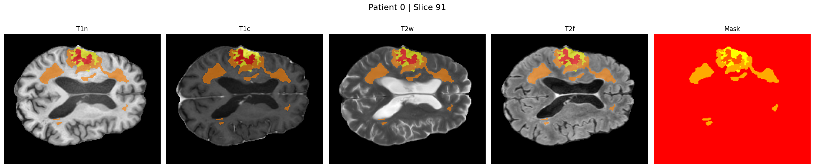
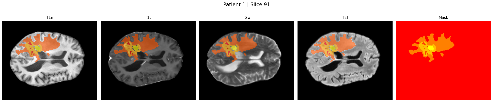
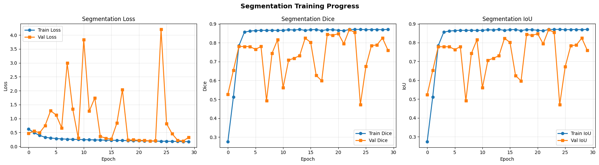

**Title:** A Lightweight Multimodal Deep Learning Framework for Brain Tumor Sub-Region Segmentation and Classification using MRI

---

> ⚠️ **Disclaimer**
>
> This document is an **annotated summary** of a private research notebook produced as part of a thesis project . It is shared solely to demonstrate the author's technical ability, methodological understanding, and depth of work.
>
> **Source code, model weights, and raw data are not disclosed.** All implementation details described here are the original work of the author. Reproduction, redistribution, or use of any part of this work without explicit written permission is strictly prohibited.

---

---

## Table of Contents

1. [Start Time](#1-start-time)
2. [All Imports](#2-all-imports)
3. [Path Setup](#3-path-setup)
4. [Dataset Handling](#4-dataset-handling)
   - [GLI Task](#41-gli-task)
   - [MEN-RT Task](#42-men-rt-task)
5. [Preprocessing](#5-preprocessing)
   - [Before Preprocessing — Visualisation](#51-before-preprocessing--visualisation)
   - [Unsharp Masking](#52-unsharp-masking)
   - [Z-Score Normalization](#53-z-score-normalization)
   - [Histogram of Preprocessing](#54-histogram-of-preprocessing)
   - [Edge Visualising Plot](#55-edge-visualising-plot)
   - [Plot Tumour Images](#56-plot-tumour-images)
6. [Model Architecture](#6-model-architecture)
   - [Attention U-Net](#61-attention-u-net)
   - [ResNet-10](#62-resnet-10)
   - [SMM-Fusion](#63-smm-fusion)
7. [Training Setup](#7-training-setup)
   - [Loader Classes](#71-loader-classes)
   - [Data Loading Setup](#72-data-loading-setup)
   - [Data Splitting](#73-data-splitting)
   - [Utility Functions & Metrics](#74-utility-functions--metrics)
8. [Attention U-Net Training](#8-attention-u-net-training)
   - [2.5D Segmentation Training](#81-25d-segmentation-training)
   - [Testing — 2.5D Model](#82-testing--25d-model)
   - [Visualisation — 2.5D Predictions](#83-visualisation--25d-predictions)
   - [2D Segmentation Training](#84-2d-segmentation-training)
   - [Testing — 2D Model](#85-testing--2d-model)
9. [Classification Training](#9-classification-training)
   - [Class Weights & Model Initialisation](#91-class-weights--model-initialisation)
   - [ResNet-10 Training](#92-resnet-10-training)
   - [SMM-Fusion Training](#93-smm-fusion-training)
10. [Training Progress Visualisations](#10-training-progress-visualisations)
11. [Auto-Disconnection](#11-auto-disconnection)

---

## 1. Start Time

Records the wall-clock time in the **Asia/Dhaka** timezone at the very start of the notebook execution. A `start_time` float (Unix epoch seconds) is also saved so total runtime can be computed at the end.

```
Training started at (Dhaka time): 2026-05-01 08:57:12 PM
```

---

## 2. All Imports

All Python libraries are imported in a single cell to keep dependencies explicit and centralised.

| Library | Purpose |
|---|---|
| `torch`, `torch.nn`, `torch.optim`, `torch.nn.functional` | Deep learning framework (PyTorch) |
| `nibabel` (`nib`) | Loading NIfTI (`.nii.gz`) MRI files |
| `numpy` | Numerical array operations |
| `matplotlib.pyplot` | Plotting and visualisation |
| `skimage.filters.unsharp_mask`, `skimage.filters.sobel` | Preprocessing — edge sharpening |
| `skimage.feature.canny` | Edge detection |
| `torch.utils.data.Dataset`, `DataLoader`, `ConcatDataset` | PyTorch data pipeline |
| `tqdm` | Progress bars for extraction loops |
| `zipfile`, `shutil`, `os`, `glob`, `time` | File I/O and timing |
| `gc` | Garbage collection / GPU memory management |

---

## 3. Path Setup

### Google Drive Mount

The notebook mounts Google Drive to access the dataset ZIP files stored at `/content/drive/MyDrive/BraTS2024/`.

```
Mounted at /content/drive
```

### Dataset Extraction

Three ZIP archives are extracted from Google Drive into the Colab local storage (`/content/BraTS2024/`) for faster I/O during training.

| ZIP File | Destination | Files | Time |
|---|---|---|---|
| `BraTS2024-BraTS-GLI-TrainingData.zip` | `BraTS-GLI/training` | 6 750 | ~15 min |
| `BraTS2024-BraTS-GLI-AdditionalTrainingData.zip` | `BraTS-GLI/training` | 1 355 | ~2 min |
| `BraTS2024-MEN-RT-TrainingData.zip` | `BraTS-MEN-RT/training` | 1 501 | ~4 min |

**Total: 9 606 files extracted in ~21.7 minutes.**

The extraction loop includes retry logic (up to 3 attempts per ZIP) that re-mounts Google Drive on failure to recover from transient I/O errors.

---

## 4. Dataset Handling

### 4.1 GLI Task

**Class: `GLIZipDataset`** (inherits `torch.utils.data.Dataset`)

Handles the **BraTS-GLI** (Glioma) dataset. Each patient folder contains four MRI modalities plus a segmentation mask.

#### MRI Modalities per Patient (GLI)

| Modality | File suffix | Description |
|---|---|---|
| T1n | `-t1n.nii.gz` | T1 native (pre-contrast) |
| T1c | `-t1c.nii.gz` | T1 with contrast enhancement |
| T2w | `-t2w.nii.gz` | T2-weighted |
| T2f (FLAIR) | `-t2f.nii.gz` | T2 Fluid-Attenuated Inversion Recovery |
| Segmentation | `-seg.nii.gz` | Ground-truth tumour mask |

#### MRI Volume Slices

Each MRI volume is a 3D NIfTI file. Raw volumes are spatially resized **per-slice** in the depth dimension:

- **H × W dimensions** are interpolated to **160 × 160** pixels using bilinear interpolation (images) and nearest-neighbour (masks).
- **D (depth) dimension is preserved as-is** — the native number of axial slices from the scanner, which is typically **155 slices** for BraTS-GLI data.

So each loaded patient tensor is shaped:

```
Image:  [4, 160, 160, D]   — 4 channels × 160 × 160 pixels × D slices
Mask:   [160, 160, D]      — single-channel segmentation × D slices
```

> **How slices are used in training:** Rather than loading the full 3D volume at once, the training loop processes **chunks of 8 slices** (`slice_chunk_size = 8`) at a time to fit within GPU memory.

#### Class Label

`class_label = 0` — used for binary tumour type classification (GLI vs MEN-RT).

---

### 4.2 MEN-RT Task

**Class: `MenRTZipDataset`** (inherits `torch.utils.data.Dataset`)

Handles the **BraTS-MEN-RT** (Meningioma Radiotherapy) dataset. This dataset provides only **T1c** as the primary modality. The other three channels (T1n, T2w, T2f) are filled with **zeros** to maintain a consistent 4-channel input shape across both datasets.

| Modality | File suffix | Value |
|---|---|---|
| T1n | — | Zero-filled |
| T1c | `_t1c.nii.gz` | Loaded from file |
| T2w | — | Zero-filled |
| T2f | — | Zero-filled |
| Segmentation | `_gtv.nii.gz` → renamed to `seg` | Ground-truth GTV mask |

Same **160 × 160 spatial resize** and depth-preserved loading as GLI.

#### Class Label

`class_label = 1` — used for binary tumour type classification (GLI vs MEN-RT).

---

## 5. Preprocessing

### 5.1 Before Preprocessing — Visualisation

**Function: `patient_slice(images, masks, patient_idx, slice_idx)`**

Displays a single axial slice from a given patient across all four modalities side-by-side (T1n, T1c, T2w, T2f) with the segmentation mask overlaid in the 5th panel. Uses the **middle slice** (`D // 2`) by default.

---

### 5.2 Unsharp Masking

**Function: `unsharp_masking(image, radius=1.0, amount=1.0)`**

Applies **Unsharp Masking** to each 2D slice independently using `skimage.filters.unsharp_mask`.

#### Formula

Unsharp masking sharpens an image by subtracting a blurred (Gaussian-smoothed) version from the original, then adding back the difference:

$$
\text{Sharpened} = \text{Original} + \text{amount} \times (\text{Original} - \text{Blurred}_{\sigma=\text{radius}})
$$

Which simplifies to:

$$
\text{Sharpened} = (1 + \text{amount}) \times \text{Original} - \text{amount} \times G_\sigma(\text{Original})
$$

where $G_\sigma$ is a Gaussian blur with standard deviation $\sigma = \text{radius}$.

#### Parameters used

| Parameter | Value | Effect |
|---|---|---|
| `radius` | 1.0 | Gaussian blur sigma — controls width of sharpening neighbourhood |
| `amount` | 1.0 | Strength of the sharpening effect |

#### Behaviour by tensor dimensionality

| `image.ndim` | Processing |
|---|---|
| 4 (C, H, W, D) | Applies per-channel, per-slice: loops over all `c` channels and all `d` depth slices |
| 3 (H, W, D) | Applies per-slice: loops over all `d` depth slices |
| 2 (H, W) | Applies directly to the single 2D image |

---

### 5.3 Z-Score Normalization

**Function: `zscore_normalize(image, eps=1e-8)`**

Applies **channel-wise Z-score normalisation** to each MRI modality independently.

#### Formula

$$
\hat{x}_c = \frac{x_c - \mu_c}{\sigma_c + \varepsilon}
$$

where:
- $x_c$ is the voxel intensity for channel $c$
- $\mu_c = \text{mean}(x_c)$ — mean intensity across all voxels in that channel's 3D volume
- $\sigma_c = \text{std}(x_c)$ — standard deviation across all voxels in that channel
- $\varepsilon = 10^{-8}$ — small constant to prevent division by zero

#### Behaviour by tensor dimensionality

| `image.ndim` | Processing |
|---|---|
| 4 (C, H, W, D) | Per-channel normalisation — each of the 4 modalities is normalised independently |
| 3 or 2 | Global normalisation — single mean and std across all voxels |

Z-score normalisation ensures each modality has zero mean and unit variance, making training more stable across the heterogeneous intensity scales of T1n, T1c, T2w, and T2f.

---

### 5.4 Histogram of Preprocessing

**Function: `pixel_intensity_histograms(images, patient_idx, slice_idx, radius, amount, bins)`**

Displays side-by-side histograms comparing pixel intensity distributions **before** and **after** unsharp masking, for all four modalities of a selected patient/slice. Non-brain background pixels (intensity = 0) are excluded. A vertical red dashed line marks the mean intensity on each histogram.

---

### 5.5 Edge Visualising Plot

Two functions visualise how unsharp masking affects edge structure:

#### `edge_detection_comparison(images, masks, patient_idx, slice_idx, ...)`

Produces a 3-row × 4-column figure:
1. **Row 1:** Original slices across all 4 modalities, with segmentation mask overlay (red)
2. **Row 2:** Unsharp-masked slices with segmentation overlay
3. **Row 3:** Edge strength difference map (Sobel filter applied to both) — `Blue = original edges`, `Red = enhanced edges after unsharp masking`

#### `edge_sharpening_analysis(images, patient_idx, slice_idx, modality_idx, ...)`

Focused 1-row × 3-column figure for a **single modality**:
1. Original slice
2. Unsharp-masked slice
3. Edge enhancement difference map with colour bar

Also prints quantitative statistics:
- Number and percentage of pixels with enhanced edges
- Mean, max, and min edge change

#### `menrt_t1c_segmentation(images, masks, ...)`

Specific to the MEN-RT dataset — shows T1c original + masked, original edges, and enhanced edges in a 2×2 grid.

---

### 5.6 Plot Tumour Images

Datasets are instantiated and visualised before full training to confirm correct loading:

```
GLI Directory Dataset loaded:   271 patients  (training split)
MEN-RT Directory Dataset loaded: 500 patients (training split)
```

Each dataset calls the visualisation functions above (patient slice view, edge comparison) for a sample of patients.

**Patient 0 — Axial slice across all 4 modalities with tumour mask overlay:**



**Patient 1 — Axial slice across all 4 modalities with tumour mask overlay:**



---

## 6. Model Architecture

### 6.1 Attention U-Net

A 2D encoder–decoder architecture with **attention gates** at each skip connection, adapted for **2.5D** inference (stacked context slices as channels).

#### Building Blocks

| Block | Description |
|---|---|
| `AttentionBlock(F_g, F_l, F_int)` | Gated attention — learns a soft spatial attention map $\psi$ to weight skip features |
| `ConvBlock(in_c, out_c, dropout=0.3)` | Double Conv2d → BN → ReLU → Dropout2d |
| `EncoderBlock(in_c, out_c)` | ConvBlock + MaxPool2d(2) — returns both feature map and pooled output |
| `Bottleneck(in_c, out_c)` | Single ConvBlock at the deepest level |
| `DecoderBlock(in_c, out_c, skip_c, att_int)` | Upsample → reduce channels → AttentionBlock on skip → concat → ConvBlock |

#### Attention Gate Formula

$$
\psi = \sigma_2 \left( \text{BN} \left( W_\psi \cdot \text{ReLU} \left( W_g \cdot g + W_x \cdot x \right) \right) \right)
$$

$$
\hat{x} = x \cdot \psi
$$

where:
- $g$ = gating signal from the decoder (coarser resolution)
- $x$ = skip connection feature map from the encoder
- $W_g$, $W_x$ = 1×1 conv projections to the intermediate dimension $F_{int}$
- $W_\psi$ = 1×1 conv to scalar attention weight
- $\sigma_2$ = sigmoid activation
- $\hat{x}$ = attended skip features passed to the decoder

#### Encoder–Decoder Channel Progression

```
Input (C_in × 160 × 160)
  │
  ├─ Encoder1: C_in → 64    │
  ├─ Encoder2: 64 → 128     │  Skip connections
  ├─ Encoder3: 128 → 256    │  with Attention Gates
  ├─ Encoder4: 256 → 512    │
  │
  ├─ Bottleneck: 512 → 1024
  │
  ├─ Decoder4: 1024 → 512  (att on skip from Enc4: 512)
  ├─ Decoder3: 512 → 256   (att on skip from Enc3: 256)
  ├─ Decoder2: 256 → 128   (att on skip from Enc2: 128)
  ├─ Decoder1: 128 → 64    (att on skip from Enc1: 64)
  │
  └─ Output Conv: 64 → out_channels (1 for segmentation)
```

#### Input channel configurations

| Mode | `in_channels` | Explanation |
|---|---|---|
| 2.5D (3 context slices) | `4 × 3 = 12` | 4 modalities × 3 consecutive slices stacked |
| 2D (single slice) | `4` | 4 modalities of one slice |

**Dropout rate:** 0.3 throughout all convolutional blocks.

---

### 6.2 ResNet-10

A lightweight 2D residual classification network for tumour type prediction (GLI vs MEN-RT).

#### Building Blocks

| Block | Description |
|---|---|
| `TripleConvBlock(in_c, out_c, stride)` | 3 × (Conv2d → BN → ReLU) with residual shortcut |
| `DoubleConvBlock(in_c, out_c, stride)` | 2 × (Conv2d → BN) with residual shortcut (not used in final model) |

#### Architecture

```
Input (C_in × 160 × 160)
  │
  ├─ Stem: C_in → 64  (Conv2d 3×3, BN, ReLU)
  ├─ Block1: 64 → 64   (TripleConv, stride=1)
  ├─ Block2: 64 → 128  (TripleConv, stride=2 → 80×80)
  ├─ Block3: 128 → 256 (TripleConv, stride=2 → 40×40)
  ├─ AdaptiveAvgPool2d(1,1) → 256-dim vector
  └─ FC: 256 → num_classes (2)
```

**Input channels:** `4 × context_slices = 4 × 3 = 12` (2.5D)

---

### 6.3 SMM-Fusion

A **Segmentation-guided Multi-Modal Fusion** network that combines features extracted from the frozen pretrained Attention U-Net and ResNet-10 backbones for final tumour type classification.

#### Architecture

```
Input → [Frozen AUNet backbone] → UNet features (1024-dim)
Input → [Frozen ResNet backbone] → ResNet features (256-dim)
         │                               │
    unet_proj (Linear 1024→512)    resnet_proj (Linear 256→512)
         │                               │
    [Auxiliary U-Net head: 512→256→2]   [Auxiliary ResNet head: 512→256→2]
         │                               │
         └───────── concat (1024-dim) ──┘
                         │
              fusion_gate (1024→512→2, Sigmoid)
                         │
          gated_unet = gate[:,0] × unet_proj
          gated_resnet = gate[:,1] × resnet_proj
                         │
          concat([gated_unet, gated_resnet]) → 1024-dim
                         │
         fusion_head (1024→512→256→2)  ← LayerNorm + Dropout
                         │
                    Final logits (2 classes)
```

#### SMM-Fusion Forward Pass (returns 5 outputs)

| Output | Description |
|---|---|
| `fused_logits` | Primary classification output (2 classes) |
| `unet_aux_logits` | Auxiliary classification from U-Net branch |
| `resnet_aux_logits` | Auxiliary classification from ResNet branch |
| `attention_weights` | Learned per-sample gate weights `[α_unet, α_resnet]` |
| `fused_features` | 1024-dim fused feature vector |

Feature dimensions confirmed at runtime:
```
UNet feature dim  : 1024
ResNet feature dim: 256
```

---

## 7. Training Setup

### 7.1 Loader Classes

Two loader classes wrap the base dataset classes and apply preprocessing and augmentation on-the-fly:

- **`GliDataLoader`** wraps `GLIZipDataset`
- **`MenRTdataLoader`** wraps `MenRTZipDataset`

Both apply the **same preprocessing pipeline** in `__getitem__`:

1. **Z-score normalisation** (`zscore_normalize`, per-channel)
2. **Unsharp masking** (`unsharp_masking`, radius=1.0, amount=1.0)
3. **3D augmentation** (`augment_3d_sample`, probability=0.7)

#### Augmentation — `augment_3d_sample(image, segmentation, aug_probability=0.7)`

With probability 0.7, one of the following augmentations is randomly applied:

| Augmentation | Operation | Image flip axis | Mask flip axis |
|---|---|---|---|
| `flip_h` (horizontal flip) | `torch.flip` | `dims=[1]` (H axis) | `dims=[0]` |
| `flip_v` (vertical flip) | `torch.flip` | `dims=[2]` (W axis) | `dims=[1]` |

> **Note:** A `rotate` augmentation (random rotation ±15° using `scipy.ndimage.rotate`) is defined in the code but is **not included** in the `np.random.choice` call — only `flip_h` and `flip_v` are active.

---

### 7.2 Data Loading Setup

**Hardware:** NVIDIA A100-SXM4-40GB GPU

| Dataset | Patients | Class Label |
|---|---|---|
| GLI (Glioma) | 271 | 0 |
| MEN-RT (Meningioma) | 500 | 1 |
| **Combined** | **771** | — |

Both datasets are concatenated with `ConcatDataset` into a single `combined_train_dataset` of **771 patients**.

---

### 7.3 Data Splitting

A **stratified train/validation split** is applied to maintain class balance.

| Parameter | Value |
|---|---|
| `val_fraction` | 0.2 (20%) |
| `split_seed` | 42 |
| `batch_size` | 32 |
| `slice_chunk_size` | 8 slices per batch step |
| `context_slices` | 3 (for 2.5D: previous, current, next slice) |

**Split result:**

| Split | Samples | Batches |
|---|---|---|
| Train | 617 | 20 |
| Validation | 154 | 5 |

A custom `collate_pad_depth` function handles variable depth `D` by padding all volumes in a batch to the same depth. CUDA pin memory is enabled for faster host→GPU transfer.

---

### 7.4 Utility Functions & Metrics

#### Segmentation Metrics

**Dice Coefficient:**

$$
\text{Dice} = \frac{2 \cdot |P \cap G| + \varepsilon}{|P| + |G| + \varepsilon}
$$

where $P$ = binary prediction (threshold 0.5), $G$ = ground-truth mask, $\varepsilon = 10^{-6}$ for numerical stability.

**IoU (Intersection over Union / Jaccard):**

$$
\text{IoU} = \frac{|P \cap G| + \varepsilon}{|P \cup G| + \varepsilon} = \frac{|P \cap G| + \varepsilon}{|P| + |G| - |P \cap G| + \varepsilon}
$$

#### Classification Metrics

**Binary classification metrics** computed from TP, TN, FP, FN:

| Metric | Formula |
|---|---|
| Accuracy | $(TP + TN) / (TP + TN + FP + FN)$ |
| Precision | $TP / (TP + FP + \varepsilon)$ |
| Recall (Sensitivity) | $TP / (TP + FN + \varepsilon)$ |
| F1 Score | $2 \cdot \text{Precision} \cdot \text{Recall} / (\text{Precision} + \text{Recall} + \varepsilon)$ |
| ROC AUC | Computed via Wilcoxon-Mann-Whitney rank statistic (no sklearn dependency) |

#### 2.5D Input Builder — `build_25d_input`

For a volume at depth position `z`, gathers `context_slices` adjacent slices (clamped to valid range) and stacks them into a single 2D input:

```
input channels = context_slices × C_modalities = 3 × 4 = 12
```

This gives each 2D prediction access to spatial context from one slice above and below.

---

## 8. Attention U-Net Training

### 8.1 2.5D Segmentation Training

**Model:** `AttentionUNet(in_channels=12, out_channels=1, dropout_rate=0.3)`

#### Optimiser & Scheduler

| Parameter | Value |
|---|---|
| Optimiser | Adam |
| Learning rate | `1e-4` |
| Weight decay | `1e-4` |
| LR scheduler | `ReduceLROnPlateau` — factor 0.5, patience 5 epochs |
| Loss function | `BCEWithLogitsLoss` |

#### Training Hyperparameters

| Parameter | Value |
|---|---|
| **Max epochs** | **50** |
| Early stopping patience | 10 epochs (no improvement in val loss) |
| Checkpoint save | Every epoch (latest + best val loss) |

#### Training Outcome

```
Resumed from checkpoint at epoch 50/50
Best val loss: 0.0824
```

The model completed all 50 epochs. The best checkpoint (`aunet25d_best_checkpoint.pth`) corresponds to the epoch achieving `val_loss = 0.0824`.

---

### 8.2 Testing — 2.5D Model

Loads `aunet25d_best_checkpoint.pth` and evaluates on the validation set, computing Dice and IoU scores. Slices are processed in chunks of 16 (`slice_chunk_size_test = 16`) during inference.

---

### 8.3 Visualisation — 2.5D Predictions

Loads the same best checkpoint and generates side-by-side visualisations of:
- Input MRI slices (4 modalities)
- Ground-truth segmentation mask
- Predicted segmentation mask (thresholded at 0.5)

---

### 8.4 2D Segmentation Training

**Model:** `AttentionUNet(in_channels=4, out_channels=1, dropout_rate=0.3)` — standard 2D (no context slices)

#### Optimiser & Scheduler

| Parameter | Value |
|---|---|
| Optimiser | Adam |
| Learning rate | `3e-4` (higher than 2.5D) |
| Weight decay | `1e-4` |
| LR scheduler | `ReduceLROnPlateau` — factor 0.5, patience 3 epochs |
| Loss function | `BCEWithLogitsLoss` |

#### Training Hyperparameters

| Parameter | Value |
|---|---|
| **Max epochs** | **10** |
| Early stopping patience | 5 epochs |
| Slice sampling | Every 4th slice (`slice_sample_rate = 4`) to reduce training time |

The 2D model is a faster baseline — fewer epochs and a sub-sampled depth dimension reduce computation, trading some accuracy for speed.

---

### 8.5 Testing — 2D Model

Loads `aunet_2d_best_checkpoint.pth` and evaluates on the full validation depth (all slices, not sub-sampled), computing Dice and IoU.

---

## 9. Classification Training

### 9.1 Class Weights & Model Initialisation

Class-balanced weights are computed from the training set label distribution:

$$
w_c = \frac{N}{2 \cdot N_c}
$$

where $N$ = total training samples, $N_c$ = number of samples for class $c$.

**Computed weights:**

```
Class 0 (GLI):     1.4225   ← upweighted (fewer samples: 271 × 0.8 ≈ 217)
Class 1 (MEN-RT):  0.7710   ← downweighted (more samples: 500 × 0.8 ≈ 400)
```

These weights are passed to `CrossEntropyLoss` to compensate for the class imbalance.

---

### 9.2 ResNet-10 Training

**Model:** `ResNet10(in_channels=12, num_classes=2)` (2.5D: 4 modalities × 3 context slices)

#### Optimiser & Scheduler

| Parameter | Value |
|---|---|
| Optimiser | Adam |
| Learning rate | `1e-4` |
| Weight decay | `1e-5` |
| LR scheduler | `ReduceLROnPlateau` — factor 0.5, patience 5 epochs |
| Loss function | `CrossEntropyLoss` (with class weights) |

#### Training Hyperparameters

| Parameter | Value |
|---|---|
| **Max epochs** | **50** |
| Early stopping patience | 10 epochs |

#### Training Outcome

```
Resumed from checkpoint at epoch 38/50
Best val loss: 0.3100
Early stopping triggered at epoch 40
```

The ResNet-10 ran from epoch 38 to epoch 40, where early stopping ended training (patience counter reached 10/10 at epoch 40, meaning no improvement since epoch 30).

**Final epoch results (Epoch 40):**

| Metric | Train | Val |
|---|---|---|
| Loss | 0.2474 | 0.7347 |
| Accuracy | 0.7757 | 0.8613 |
| Precision | 0.9733 | 0.8250 |
| Recall | 0.6735 | 1.0000 |
| F1 | 0.7961 | 0.9041 |
| AUC | 0.9279 | 0.9113 |

---

### 9.3 SMM-Fusion Training

The SMM-Fusion model uses the **frozen** pretrained backbones (no gradient updates to AUNet or ResNet). Only the fusion network parameters are trained.

**Backbones loaded:**
```
AUNet source : aunet25d_best_checkpoint.pth
ResNet source: resnet25d_best_checkpoint.pth
```

#### Optimiser & Scheduler

| Parameter | Value |
|---|---|
| Optimiser | Adam |
| Learning rate | `1e-3` |
| Weight decay | (set in code) |
| Loss function | `CrossEntropyLoss` (with class weights) |

#### Training Hyperparameters

| Parameter | Value |
|---|---|
| **Max epochs** | **30** |
| Early stopping patience | 10 epochs |

#### Training Outcome

```
Starting from epoch 1 (no prior checkpoint)
Early stopping / interrupt triggered after epoch 1
```

The SMM-Fusion training was interrupted after only 1 epoch (Colab session timeout or manual interrupt).

**Epoch 1 results:**

| Metric | Train | Val |
|---|---|---|
| Loss | 0.7301 | 0.5780 |
| Accuracy | 0.7590 | 0.8613 |
| Precision | 0.8510 | 0.8250 |
| Recall | 0.7668 | 1.0000 |
| F1 | 0.8067 | 0.9041 |
| AUC | 0.8760 | 0.9118 |

---

## 10. Training Progress Visualisations

**Function: Unified Evaluation Cell**

Loads training history from saved checkpoints and plots:

- **Segmentation models (2.5D and 2D):** 3-panel plots — Loss, Dice, IoU per epoch (train + val)
- **ResNet-10 classification:** 2-panel plots — Loss and Accuracy per epoch (train + val)
- **SMM-Fusion classification:** similar classification plots

Prints a final **summary table** of best metrics across all models.

**Segmentation — Train vs Validation curves (Loss, Dice, IoU):**



---

## 11. Auto-Disconnection

Computes total runtime from the `start_time` saved at the beginning:

```python
total_time = end_time - start_time
```

Prints runtime in hours/minutes/seconds and the current Dhaka time, then executes a JavaScript call to **disconnect the Colab runtime** automatically, releasing GPU resources:

```python
Javascript('google.colab.kernel.disconnect()')
```

---

## Summary: Epochs and Key Parameters

| Model | Max Epochs | Actual Epochs Run | Best Val Loss | Notes |
|---|---|---|---|---|
| Attention U-Net (2.5D seg.) | 50 | 50 (full) | 0.0824 | Resumed from ckpt |
| Attention U-Net (2D seg.) | 10 | — | — | No output captured |
| ResNet-10 (2.5D class.) | 50 | ~40 (early stop) | 0.3100 | Stopped at epoch 40 |
| SMM-Fusion (class.) | 30 | 1 (interrupted) | — | Session interrupted |

## Summary: Dataset and Slice Information

| Dataset | Patients (train) | Modalities | Spatial Size | Depth (D) | Augmentation |
|---|---|---|---|---|---|
| BraTS-GLI (Glioma) | 271 | T1n, T1c, T2w, T2f + seg | 160 × 160 (resized) | Preserved (~155 slices) | flip_h / flip_v (p=0.7) |
| BraTS-MEN-RT (Meningioma) | 500 | T1c only (others zero) + seg | 160 × 160 (resized) | Preserved | flip_h / flip_v (p=0.7) |
| **Combined** | **771** | — | — | — | — |

---

*This document was generated by reading and annotating `T__2520848.ipynb`.*
